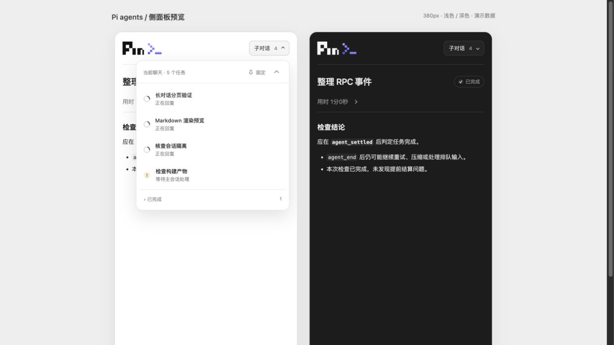

# Pi in Codex

<p align="center">
  
</p>

<p align="center">
  <strong>把活交给独立的 pi 子对话，你继续留在当前 Codex 聊天里干活。</strong>
</p>

<p align="center">
  <a href="README.md">English</a> · 简体中文
</p>

<p align="center">
  <a href="#快速开始">快速开始</a> ·
  <a href="#更多用法">更多用法</a> ·
  <a href="#完整工具清单">工具清单</a> ·
  <a href="#运行边界">运行边界</a> ·
  <a href="#文档导航">文档导航</a> ·
  <a href="LICENSE">MIT 许可证</a>
</p>

**Pi in Codex** 在当前 Codex 聊天里运行各自独立的 pi 子对话：主会话不被打断，
子对话在同一项目目录中自己干活，结果在安全点回传。只读侧面板实时展示每个
子对话的状态与过程。

每个子对话都是真正的 pi 会话，使用自己的模型、认证和工具。它不复制父会话
上下文，也不继承 Codex 沙箱。同一项目中的不同聊天分别管理各自的子对话。
这些不是 Codex 原生子代理。



*截图使用模拟数据，面板只读。*

## 能做什么

| 能力 | 你可以用它做什么 |
| --- | --- |
| **按需投喂上下文的委派** | 只把你选定的上下文交给子对话，父会话继续做自己的事。 |
| **实时只读面板** | 结论优先、过程折叠：工具调用、命令和消息按需加载，每页最多 50 条。 |
| **运行中可控** | 运行中纠偏、排队跟进、软中断，或释放进程。 |
| **多任务并行** | 默认全局 4 个、每个聊天 2 个，公平调度。 |
| **安全点回传** | 完成结果在轮次之间交给原来的父聊天，不会插到你工作的中间。 |
| **历史可恢复** | 已结束的对话可再发一条消息继续；归档任务保留完整记录。 |
| **只读排查档位** | 可选 `reviewer` / `explorer` 限制子对话只能读。详见下方边界说明。 |
| **模型可发现** | 启动前查询你本机 pi 实际提供的模型与思考档位。 |

## 快速开始

需要三样东西：**Codex 桌面客户端**、已配置好的 **pi**，以及本**插件**（并且它的
hooks 已被信任）。

| 组件 | 要求 |
| --- | --- |
| 宿主 | macOS。支持 MCP Apps 会话面板、逐次调用 thread 元数据与可信插件 hooks 的 Codex 桌面客户端；开发基准 Codex `26.1013.31256`。 |
| 运行环境 | pi **1.2.0+**，已安装并用你自己的模型认证配置好。 |
| Node.js | **22.19+**（安装器会记录它使用的 Node 路径）。 |
| 分发方式 | 从 [GitHub 源码](https://github.com/more-nico/pi-in-codex)或 [Releases](https://github.com/more-nico/pi-in-codex/releases) 的 macOS 预构建包安装。 |

### 1. 从源码安装

```sh
git clone https://github.com/more-nico/pi-in-codex.git
cd pi-in-codex
npm ci
npm run check
node bin/pi-in-codex.mjs doctor
node bin/pi-in-codex.mjs install
```

使用预构建包时，从 [v0.1.1](https://github.com/more-nico/pi-in-codex/releases/tag/v0.1.1)
下载 `pi-in-codex-0.1.1-macos.zip` 与 `SHA256SUMS`，放在同一目录，再执行：

```sh
shasum -a 256 -c SHA256SUMS
unzip pi-in-codex-0.1.1-macos.zip
cd pi-in-codex
node bin/pi-in-codex.mjs doctor
node bin/pi-in-codex.mjs install
```

发布包包含依赖与文档，无需 `npm ci` 或构建，仍然使用你自己的 Node 和 pi。

安装器把构建产物复制到 `~/.codex/plugins/pi-in-codex`，合并写入
`~/.agents/plugins/marketplace.json`，并在修改前备份该目录文件。请务必通过安装器
安装：它会为实际安装位置解析 MCP 与 hooks 脚本路径，直接复制源码模板是无效的。

<details>
<summary><b>隔离测试安装</b></summary>

正式安装前先用 `node bin/pi-in-codex.mjs doctor` 看看会动到哪些路径。

```sh
node bin/pi-in-codex.mjs install --codex-home /绝对路径/测试目录
```

对应的 marketplace 位于该目录的 `.agents/plugins/marketplace.json`；如需让桌面端
发现它，就把该目录添加为本地插件来源。卸载时同样带上这个 `--codex-home`。

</details>

### 2. 启用插件并信任 hooks

重启 Codex 桌面客户端，在本地插件来源中找到 **Pi in Codex**，安装并启用它，然后
**检查并信任它的 hooks**，再开始新一轮对话。启用插件本身不会自动信任 hooks；没有
hooks 就没有自动的安全点回传，得由父会话用 `pi_read`、`pi_events` 主动读取。从当前会话面板打开 **Pi agents**，
或者让 Codex 调用 `pi_panel`。

<!-- TODO: 截图 — 插件详情页，hooks 显示为已信任。 -->

### 3. 用一句话试用

> 用一个 pi 子对话检查鉴权模块，把相关上下文给它，然后你在这里继续干活。

自带的 skill 会教 Codex 这套流程：先估算工作量，再带着真正需要的上下文启动子对话，
父会话继续推进。启动或恢复任务前，Codex 会估计耗时并给出大致区间；如果判断是
5–10 分钟的任务，就会把 `pi_wait` 的上限设成对应的 `600000` 这类值。提前完成会立即
结束等待；超时的任务仍在继续跑。

面板是只读的：在里面看结论、按需展开执行历史。发指令、回答 pi 扩展的输入请求、
停止子对话都由 Codex 在父聊天中通过工具完成，面板不提供输入框。

派活或发消息后，Codex 会检查当前聊天是否需要打开面板。已有面板就原地更新，保留
你正在看的任务；首次打开时优先显示正在运行的任务。

## 更多用法

### 多个子对话并行

一句话里可以同时要求多个子对话。`name` 只是显示名，后续调用用 `agentId`：启动时返回的
UUID，或设置 `path` 之后这个在当前聊天内唯一的路径；分组用于过滤。默认全局 **4 个**、每个聊天 **2 个**，公平调度；
等待输入的子对话会一直占用一个名额，直到被回答或停止。子对话共用你指定的目录，
所以写操作请自己划分清楚，别让两个子对话改同一批文件。

### 选择模型与思考档位

模型和思考档位来自 pi 本身，不是本插件写死的，清单是实时查询的。让 Codex 调用
`pi_models` 查看本机可用模型，也可以先探测某个模型再派活；启动时用
`{provider,id,thinking}` 指定，省略 `model` 就用 pi 自己的默认值。其他服务商凭证相关
环境变量可以加进 manifest 的 `env_vars`；文件形式的 pi 凭证无需复制，也不会暴露给面板。

### 引导、跟进与中断

| 场景 | 用什么 |
| --- | --- |
| 纠正正在运行的子对话 | `pi_send` 的 steer 模式，消息进入当前这一轮。 |
| 当前任务结束后再加活 | `pi_send` 的 `followUp` 模式，或 `pi_follow_up` 显式启动/排队。 |
| 继续一个已结束的对话 | `pi_send` 或 `pi_follow_up`：会话恢复，每轮运行有新的 ID。 |
| 中断本轮但保留进程 | `pi_interrupt`。 |
| 中断并释放进程 | `pi_stop`。 |
| 只递信息，不唤醒空闲子对话 | `pi_message`。 |

### 等待结果

`pi_wait` 会阻塞，所以参数要求很明确：

| 参数 | 行为 |
| --- | --- |
| `agentIds` | 必填，指定等哪些子对话。 |
| `timeoutMs` | 必填，`0`–`3600000`（最长 60 分钟）。这是上限，不是轮询间隔。 |
| `runIds` | 可选的 agent→run 映射，用于等某一次具体运行而不是下一次。 |
| `afterCursor` | 上一次等待返回的游标。连续等待时复用它，跳过旧结果。 |
| `mode` | `any`（默认）或 `all` 决定要等齐哪些子对话；新消息和待输入也会提前唤醒等待。 |

等待可以提前返回：任务完成、有新消息、或子对话需要父会话响应扩展请求。只有 `agent_settled`
代表一轮真正结束；已接受的提示词、`agent_end`、重试和上下文压缩都不算。超时后任务
继续运行。插件自身的 MCP 超时覆盖完整一小时，但宿主可能有更短的限制。

结果按游标或稳定 ID 读取，不用反复追问子对话：`pi_events` 按游标看信箱预览（或按
`eventId` 看完整通知），`pi_result` 按稳定的 `completionId` 分页读完整结果（包括更早
的运行），`pi_ack` 在父会话读完之后确认 ID。未被确认的结果可能在后续轮次再次投递，
所以重复处理是显式的；很长的结果会给出预览加一个 `pi_result` 引用。
spawn/send/message/follow_up 上的 `requestId` 去重是尽力而为的幂等，不是 exactly-once。

子对话侧也可以用自带的 `pi_report` 工具，在不结束任务的前提下向父会话报告进度或
阻塞；pi 扩展的输入请求走同样的安全点 hooks，由 Codex 用 `pi_reply` 回答。`pi_report`
是 pi 侧工具，不算第 18 个 MCP 工具。

## 完整工具清单

插件共暴露 **17 个 MCP 工具**。创建子对话只需要 `name` 和 `task`。`pi_poll` 仅供面板
使用；`pi_models` 父会话也可以调用；变更类工具只给模型。

<details>
<summary><b>17 个工具及作用</b></summary>

| 工具 | 作用 |
| --- | --- |
| `pi_spawn` | 以指定名称启动任务，带显式上下文、目录和可选 `{provider,id,thinking}` 模型 |
| `pi_list` | 列出当前聊天下的子对话 |
| `pi_read` | 读取最近 N 条消息（默认 5，最多 200），可选工具/部分文本，`before` 分页 |
| `pi_send` | 运行中引导（`steer`）或排队下一个任务（`followUp`） |
| `pi_stop` | 中断执行并释放进程，历史保留 |
| `pi_wait` | 按 `agentIds` 等待，必填 `timeoutMs`（0–3,600,000）；完成、新消息或扩展请求待响应时提前返回 |
| `pi_ack` | 父会话读完结果后确认完成 ID |
| `pi_reply` | 在父聊天中回答 pi 扩展的输入、选择或确认请求 |
| `pi_message` | 传递信息但不唤醒空闲的子对话 |
| `pi_follow_up` | 显式启动或排队下一个任务 |
| `pi_interrupt` | 中断本轮运行，但保留可继续用的进程 |
| `pi_events` | 按游标读信箱预览，或按 `eventId` 读一条完整通知 |
| `pi_result` | 按稳定的 `completionId` 分页读完整结果，含更早的运行 |
| `pi_models` | 启动前发现模型，可选地探测指定模型 |
| `pi_archive` | 归档或恢复已结束任务，保留历史与待取结果 |
| `pi_panel` | 打开当前聊天的只读侧面板 |
| `pi_poll` | 面板自身使用的轮询工具 |

</details>

## 运行边界

<details>
<summary><b>任务在哪里跑，什么并不是隔离</b></summary>

- 每个子对话都是独立的 pi 会话：不复制父会话记录，也不继承 Codex 沙箱；pi 用它
  自己的工具和权限运行，认证由 pi 自己配置。
- pi 从自己的配置读取凭证，既不会复制进本插件，也不会暴露给面板。
- 面板或 MCP 连接关闭后，本地守护进程继续运行；完成结果落盘排队，由 PostToolUse、
  Stop、UserPromptSubmit、SessionStart hooks 在安全点投递给**原来的父聊天**。
  Stop hook 对新投递的结果只续跑一次，不会循环等待。
- 空闲的父聊天不会被主动唤醒：下一轮再取待投递结果。
- 已结束的进程 5 分钟后释放，需要时从 pi 会话恢复。守护进程重启会把未完成工作标为
  中断，而不是悄悄重放；重装、升级和卸载会停掉旧守护并中断在跑的任务。
- `reviewer` 与 `explorer` 是工具白名单加扩展门禁，**不是操作系统沙箱**。它们用来
  防止子对话写文件，不用来隔离不可信代码。
- 缺少 thread 元数据时直接报错；插件绝不按目录、最近活跃窗口或进程级
  `CODEX_THREAD_ID` 猜测父聊天。
- 状态与记录位于 `${CODEX_HOME:-~/.codex}/pi_in_codex`，其中包含任务文本和工具输出，
  请把它当作你的编码助手记录来对待。socket 与数据文件仅本机用户可读。

</details>

### 配置

| 环境变量 | 默认值 |
| --- | --- |
| `PI_IN_CODEX_PI_PATH` | PATH 中的 `pi` |
| `PI_IN_CODEX_NODE_PATH` | 安装器记录的 Node 路径 |
| `PI_IN_CODEX_DATA_DIR` | Codex 用户数据目录下的 `pi_in_codex` |
| `PI_IN_CODEX_CONCURRENCY` | `4`（1–32） |
| `PI_IN_CODEX_CHAT_CONCURRENCY` | `2`（1–32） |
| `PI_CODING_AGENT_DIR` | pi 自己的默认目录（`~/.pi/agent`） |

启动器会把 Node 的 bin 目录和 Homebrew 路径加到 `PATH` 前面。如果 pi 装在别处，
就在 MCP 环境里把 `PI_IN_CODEX_PI_PATH` 指向它的可执行文件绝对路径。

### 升级与卸载

```sh
node bin/pi-in-codex.mjs doctor        # 环境与安装检查
node bin/pi-in-codex.mjs daemon-stop   # 停止本地守护进程
node bin/pi-in-codex.mjs uninstall     # 移除插件目录与 marketplace 条目
```

卸载只删除带标记的插件目录和它自己的 marketplace 条目，保留历史记录。守护进程诊断
日志是数据目录里的 `daemon.log`。重装升级会停掉旧守护并中断在跑的任务，请先让
子对话收尾或手动停止。安装器等待旧进程实际退出后才替换文件；客户端核对构建指纹，
自动替换旧守护，并拒绝把新版守护降级。升级后请重启 Codex，刷新缓存的客户端；
`doctor` 会显示两端构建标识及是否兼容。

## 面板

结论优先，过程按需展开。已完成的子对话默认只显示最终 Markdown 总结；点击**用时**那一行折叠区，才展开
工具调用与消息，并按需加载更早的记录。

- 用户与助手消息渲染 Markdown：表格、任务列表、代码围栏、引用和链接；命令与工具
  输出保持原文并折叠显示。
- 每页最多 50 条消息，向上翻找时按需加载更早的记录。
- 不渲染原始 HTML；Markdown 中的图片渲染成链接，不会自动下载。
- 面板只读；右上角的子对话列表可以展开、折叠，也能固定成浮层，切换任务时不收起。

当前源码包含尚未发布的性能更新：自动刷新合并到约每秒 4 次，复用未变化消息的渲染结果，
折叠详情按需挂载。长文本先展示 8,000 字符预览，主动阅读时每段 16,000 字符，完整原文保留。
这些限速只作用于面板，不影响主会话接收完成结果。

## 文档导航

| 文档 | 内容 |
| --- | --- |
| [docs/SUBAGENT_PARITY.md](docs/SUBAGENT_PARITY.md) | 调用与协作语义、模式、档位与参数说明 |
| [docs/INTERFACE.md](docs/INTERFACE.md) | 面板信息规划：布局、交互和展示范围 |
| [docs/VALIDATION.md](docs/VALIDATION.md) | 已在基准宿主上验证的内容，以及尚未覆盖的部分 |
| [THIRD_PARTY_NOTICES.md](THIRD_PARTY_NOTICES.md) | 第三方许可声明 |
| [LICENSE](LICENSE) | MIT |

没有注册 hooks 时，请在桌面端启用并信任它们，再开始新一轮对话。如果宿主无法暴露
thread 入口，工具仍然可用，但桌面端验收不算完成。

## 开发

```sh
npm run check      # 类型检查 + 测试（test 会先构建）
npm run dev:ui     # 面板预览，http://127.0.0.1:4173
npm run pack:plugin # 插件 ZIP 输出到 release/
```

`http://127.0.0.1:4173/?demo=1` 用的是模拟数据，不会启动真实子对话，也不能证明与
Codex 宿主的集成；`/preview.html` 对比 380px 宽度的浅色/深色面板，
`/?demo=1&markdown=1` 预览 Markdown 渲染效果。测试会跑真实的 stdio、Unix socket 和
MCP 传输，对端是一个确定性的假 pi；真实模型冒烟测试单独运行，因为它消耗你的模型
额度。面板挂载、hooks 信任、双窗口路由仍需在已安装的桌面端里验收。插件 ZIP 输出到
`release/`（当前为 `pi-in-codex-0.1.1-macos.zip`）。

带 hooks 的插件目前仍需手动安装，不在公开插件目录里；参见官方
[打包文档](https://developers.openai.com/plugins/build/plugins)。发布产物不含任何
OpenAI 桌面端代码，保留的许可声明见 `dist/DEPENDENCY_NOTICES.txt`。

## 许可证

MIT。见 [LICENSE](LICENSE) 与 [THIRD_PARTY_NOTICES.md](THIRD_PARTY_NOTICES.md)。

这是独立社区项目，与 OpenAI、Earendil 没有隶属或背书关系。产品名称与商标归各自
所有者；MIT 许可不授予商标权。紫色终端符号为本项目原创图形，并非 Codex 官方 Logo。
